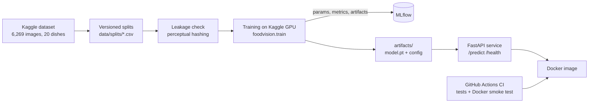

# 🍛 Food Vision: Indian Dish Classifier with an MLOps Pipeline

[](https://github.com/ankitparate05/food-vision/actions/workflows/ci.yml)

Upload a photo of an Indian dish → get the **top-3 predicted dishes** with confidence and **approximate nutrition**.
A fine-tuned **EfficientNet-B0** recognises **20 dishes** with **93.5% top-1 / 97.5% top-3 accuracy**, served by a **FastAPI** service in **Docker**, tested in **GitHub Actions CI**.

The focus is not just the model but the engineering around it: versioned data splits, a data-leakage check, experiment tracking, one shared preprocessing path for training and serving, and automated tests.

---

## Results (baseline: EfficientNet-B0)

Evaluated once on a held-out test set of **941 images** (15% stratified split, never used for training or model selection).

| Metric | Score |
|---|---|
| Top-1 accuracy | **93.5%** |
| Top-3 accuracy | **97.5%** (the app shows 3 suggestions, so this is what users experience) |
| Macro-F1 | **0.935** (every dish weighted equally) |
| Best validation accuracy | 90.7% |
| Model size | 4.0M parameters, 16 MB |
| CPU inference latency | ~70–90 ms per image |

<p align="center">
  
</p>

Two-phase fine-tuning: 3 epochs training only the new classifier head, then 7 epochs unfreezing the whole network. Validation accuracy jumps from 75% to 88% the moment the backbone is unfrozen.

### Error analysis: where the model fails

<p align="center">
  
</p>

| Weakest classes | F1 | Pattern |
|---|---|---|
| dal_makhani | 0.833 | confused with **pav_bhaji**: both orange-red gravies |
| pav_bhaji | 0.874 | same gravy confusion |
| chapati | 0.885 | confused with **butter_naan**: flatbreads |
| butter_naan | 0.889 | same flatbread confusion |

Errors cluster in **visually similar food groups** (gravies, flatbreads), not at random: the model has learned meaningful visual features, and the remaining errors are ones a person might also make from a single photo.

**Honest caveats**
- Test accuracy (93.5%) is ~3 points above validation (90.7%). With ~940 images per split, part of that is split noise, so the realistic range is **~91–93%**.
- Train accuracy reaches 99% while validation plateaus at ~91%: the model **overfits**. Step 2 tests stronger augmentation and a larger backbone against this.
- The dataset is web-scraped, so duplicate photos may cross splits. `scripts/check_duplicates.py` measures this (Step 2).

---

## Architecture



## MLOps practices

| Practice | Where | Why it matters |
|---|---|---|
| **Versioned data splits** | `data/splits/` | Every experiment is compared on exactly the same images |
| **Data-leakage check** | `scripts/check_duplicates.py` | Duplicate photos across train/test would inflate the score |
| **Experiment tracking** | MLflow in `foodvision/train.py` | Every run's parameters, curves and artifacts are recorded and comparable |
| **Model selection on validation only** | `notebooks/02_experiments_kaggle.ipynb` | The test set stays an unbiased final check |
| **One preprocessing path** | `foodvision/transforms.py` + `model_config.json` | The API resizes and normalises exactly as in training (avoids training/serving skew) |
| **Weights out of git** | `.gitignore`, `artifacts/README.md` | Code is versioned in git; large binaries are not |
| **Automated tests** | `tests/` (36 tests) | Predictor, API errors, splits, nutrition table, duplicate detection |
| **CI + container smoke test** | `.github/workflows/ci.yml` | Every push runs the tests, builds the image and calls `/predict` inside it |

---

## Project structure

```
food-vision/
├── src/foodvision/
│   ├── data.py            # dataset discovery, validation, splits
│   ├── transforms.py      # train augmentation + the shared eval/serving transform
│   ├── model.py           # EfficientNet-B0 / ConvNeXt-Tiny factory
│   ├── train.py           # two-phase training CLI with MLflow tracking
│   ├── predictor.py       # loads artifacts, runs inference
│   ├── api.py             # FastAPI app
│   ├── nutrition.json     # approximate per-serving nutrition table
│   └── static/index.html  # upload page
├── scripts/
│   ├── check_duplicates.py
│   └── make_dummy_artifacts.py
├── notebooks/
│   ├── 01_baseline_training.ipynb    # Step 1: baseline (results above)
│   └── 02_experiments_kaggle.ipynb   # Step 2: leakage check + tracked experiments
├── data/splits/           # versioned train/val/test lists
├── reports/baseline/      # metrics, history, figures
├── tests/
├── Dockerfile
└── .github/workflows/ci.yml
```

---

## Run it

### API locally
```bash
pip install torch torchvision --index-url https://download.pytorch.org/whl/cpu
pip install -r requirements-api.txt && pip install -e .

# put model.pt, class_names.json, model_config.json in ./artifacts (see artifacts/README.md)
uvicorn foodvision.api:app --reload
```
Open http://127.0.0.1:8000 for the upload page, or http://127.0.0.1:8000/docs for the interactive API docs.

```bash
curl -F "file=@my_dosa.jpg" http://127.0.0.1:8000/predict
```

### Docker
```bash
docker build -t food-vision .
docker run -p 7860:7860 food-vision      # http://localhost:7860
```

### Train
```bash
pip install -r requirements.txt && pip install -e .
python -m foodvision.train --data-dir /path/to/dataset --splits-dir data/splits \
    --model efficientnet_b0 --output-dir outputs/run1
mlflow ui --backend-store-uri sqlite:///mlflow.db
```

### Check for duplicate images
```bash
python scripts/check_duplicates.py --data-dir /path/to/dataset --splits-dir data/splits
```

### Tests
```bash
pip install -r requirements-dev.txt && pytest
```

---

## Roadmap

- [x] **Step 1:** baseline EfficientNet-B0 (93.5% top-1)
- [x] Packaged training code, FastAPI service, Docker image, tests, CI
- [ ] **Step 2:** duplicate-leakage audit + MLflow comparison: EfficientNet-B0 (basic vs strong augmentation) vs ConvNeXt-Tiny
- [ ] **Step 3:** deploy to Hugging Face Spaces (public demo link)

## Limitations

- Knows only **20 dishes**. Anything else gets mapped to the closest of them; the API flags predictions below 50% confidence.
- **Nutrition values are approximate table lookups** for a typical serving, not estimated from the photo. Portion size can't be judged reliably from one image.
- Web-scraped training data: photos are often well-lit and plated, so accuracy on everyday phone photos may be lower.

## Data

[Indian Food Classification](https://www.kaggle.com/datasets/l33tc0d3r/indian-food-classification) by Pushkar Jain (Kaggle): 6,269 valid images across 20 classes.

---

**Author:** Ankit Parate
